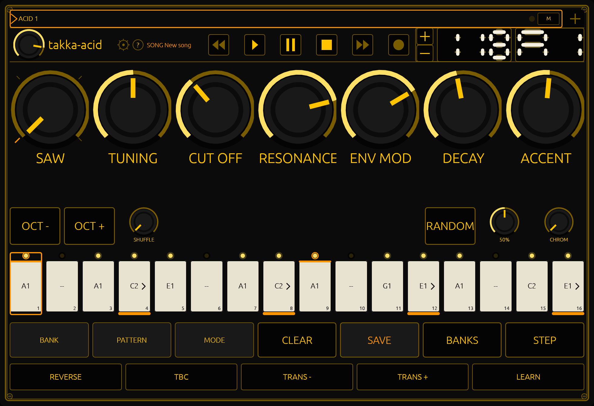
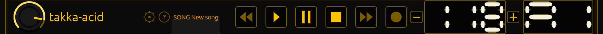
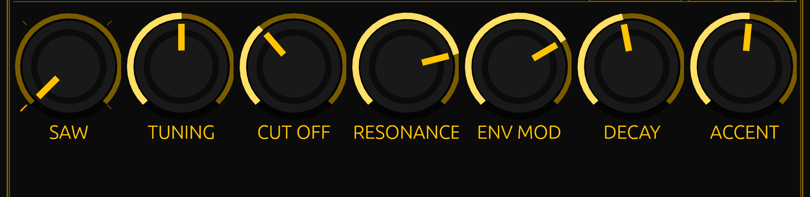
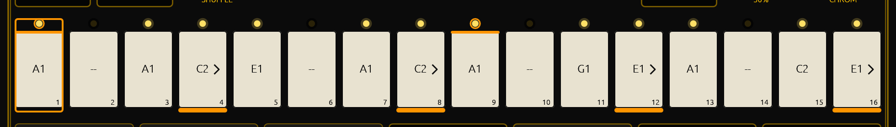
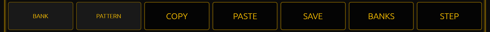

# The face

Seven bands, top to bottom. Read them in the order your eye meets them and the whole machine is named.

## The strip

The band the panel gained, and the only one that is about the rack rather than about the device on it: a cell per device —
its name, a lamp while it runs, its `M` mute — the cell the panel is showing outlined, and `+` at the right end to add
another. [`18-a-rack-of-devices`](18-a-rack-of-devices.md) is that page.

## The top strip

- **The volume knob**, in the left corner, standing alone — the level out of the machine, not part of the sound.
- **The wordmark** `takka-acid`.
- **the song name**, in the band's left cluster: amber while you have unsaved changes, plain silk once the session is on
  disk. [`03-first-sound`](03-first-sound.md) explains the two states.
- **The gear** and the **`?`** — the two round keys that open the settings card and the help card.
- **The tape deck**, six keys drawn as shapes rather than letters: `BACK`, `PLAY`, `PAUSE`, `STOP`, `FWD` and `REC`;
  `PLAY` and `PAUSE` light from the transport, and the three that are not wired stay dim.
  [`09-playing`](09-playing.md) is the page for them.
- **The tempo stepper** beside the pattern readout: a small `-` and `+` stacked at the number's left, a BPM at a press.
- **Two readouts** at the right: the pattern that is playing (`A1` … `H8`), and the tempo in BPM. Both are seven-segment
  displays, and both answer the pointer: hover one and it says what it is.

## The knob row

Seven knobs, in the order the panel draws them: **SAW** (the wave), **TUNING**, **CUT OFF**, **RESONANCE**, **ENV MOD**,
**DECAY**, **ACCENT**. [`06-the-knobs`](06-the-knobs.md) takes them one at a time.

## The performance row

The things you reach for while the line is running: **`OCT -`** and **`OCT +`** to move the whole line an octave,
**`CLEAR`** to empty the pattern (in two clicks), **`RANDOM`**, the **`SHUFFLE`** knob, and the density and scale knobs — the
last printing the scale it is sitting on (`CHROM` for chromatic). [`10-performance-row`](10-performance-row.md) is that page.

## The step row

Sixteen keys, one per step, each printing its note (`A1`, `C2`, `E1`, or `--` for a rest), and a row of small LEDs above: one
lit while that step is playing or holds a note, and ringed when the step is accented. The step you have selected wears an
amber outline around the whole key.

In the corner of each keycap, its number, 1 to 16. An amber bar under a keycap means slide; the `>` beside the note says it will
really glide into the next step. A slide whose next step is a rest keeps the bar but drops the arrow, because there is
nothing for it to glide into.

## The switches

Seven keys. Five of them work today: **`COPY`** and **`PASTE`** move the pattern through the clipboard
([`21-copy-and-paste`](21-copy-and-paste.md)), **`SAVE`** writes the session to disk, **`BANKS`** opens the bank browser, and
**`STEP`** turns on the mode where the computer keyboard types a line instead of playing it. The other two — **`BANK`** and
**`PATTERN`** — are engraved and silent: there is nothing behind them yet, and the bank is moved from the keyboard or a
learned controller instead ([`11-the-bank`](11-the-bank.md)).

## The transport

**`REVERSE`**, **`TRANS -`** and **`TRANS +`** with the transpose's own readout between them, **`TBC` twice**, and
**`LEARN`**. `REVERSE` is this device's direction and the transpose pair moves the whole rack; `LEARN` is how a MIDI
controller gets taught a control ([`14-midi`](14-midi.md)). The deck above is the transport
([`09-playing`](09-playing.md)); this row is the performance.

## The panel is one piece, and it scales

Everything above is drawn on a face designed at 980 × 670 and scaled as a single piece to the window, between 0.65× and
1.6× — so a small window shows the same machine, smaller, and a large one shows it larger, never reflowed and never
rearranged. The screenshots in this book show it at its design size.

Two consequences worth knowing: a window dragged small does not hide controls, it shrinks them, so the answer to "where
did the `STEP` key go" is never "off the edge"; and a knob's sweep is the same 180-pixel pull at any window size — only the
knob's size changes — so "a third of the way" means the same thing small and large.

[`05-the-three-cards`](05-the-three-cards.md) covers the cards that open over this face: help, settings, songs, a device's card,
a drum machine's kit browser, and the picker.
