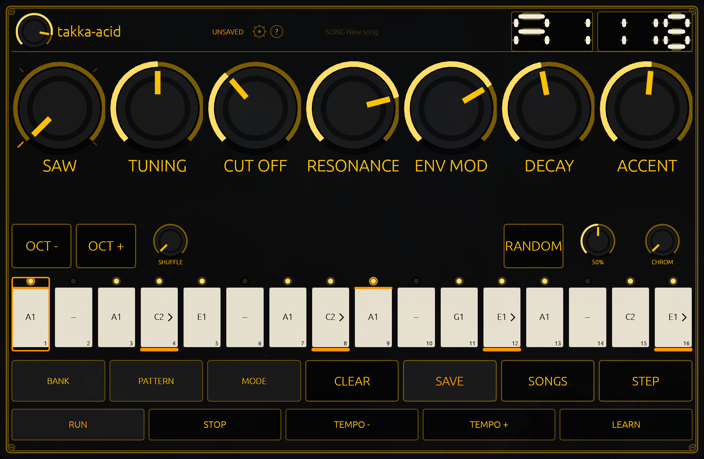
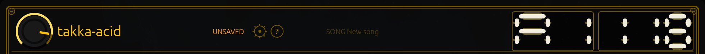
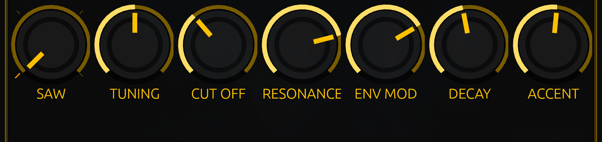
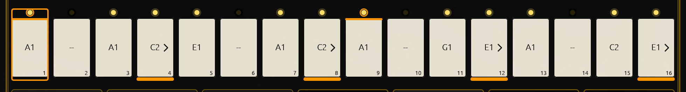
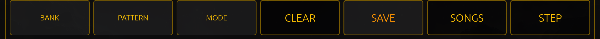
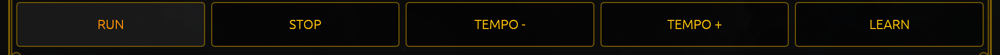

# The face

Six bands, top to bottom. Read them in the order your eye meets them and the whole machine is named.

## The top strip

- **The volume knob**, in the left corner, standing alone — the level out of the machine, not part of the sound.
- **The wordmark** `takka-acid`.
- **`SAVED` / `UNSAVED`**, the lamp: whether what you see is on disk. `03-first-sound` explains the two words.
- **The gear** and the **`?`** — the two round keys that open the settings card and the help card.
- **`SONG`** and the session's name, in the middle. It is the song's name, not a file path; a session with no name shows
  what a new song is called.
- **Two readouts** at the right: the pattern that is playing (`A1` … `H8`), and the tempo in BPM. Both are seven-segment
  displays, and both answer the pointer: hover one and it says what it is.

## The knob row

Seven knobs, in the order the panel draws them: **SAW** (the wave), **TUNING**, **CUT OFF**, **RESONANCE**, **ENV MOD**,
**DECAY**, **ACCENT**. `06-the-knobs` takes them one at a time.

## The performance row

The things you reach for while the line is running: **`OCT -`** and **`OCT +`** to move the whole line an octave, the
**SHUFFLE** knob, **`RANDOM`** with its density and its scale, and the scale knob itself, which prints the scale it is
sitting on (`CHROM` for chromatic). `10-performance-row` is that page.

## The step row

Sixteen keys, one per step, each printing its note (`A1`, `C2`, `E1`, or `--` for a rest), and a row of small LEDs above:
Sixteen keys, one per step, each printing its note (`A1`, `C2`, `E1`, or `--` for a rest), and a row of small LEDs above: one
lit while that step is playing or holds a note, and ringed when the step is accented. The step you have selected wears an
amber outline around the whole key.

Under the keys, the step numbers 1 to 16. An amber bar under a keycap means slide; the `>` beside the note says it will
really glide into the next step. A slide whose next step is a rest keeps the bar but drops the arrow, because there is
nothing for it to glide into.

## The switches

Seven keys. Four of them work today: **`CLEAR`** empties the pattern (in two clicks), **`SAVE`** writes it to disk,
**`SONGS`** opens the songs card, and **`STEP`** turns on the mode where the computer keyboard types a line instead of
playing it. The other three — **`BANK`**, **`PATTERN`** and **`MODE`** — are engraved and silent: there is nothing behind
them yet, and the bank is moved from the keyboard or a learned controller instead (`11-the-bank`).

## The transport

**`RUN`**, **`STOP`**, **`TEMPO -`**, **`TEMPO +`**, **`LEARN`**. The first four are the clock; `LEARN` is how a MIDI
controller gets taught a control (`14-midi`).

## The panel is one piece, and it scales

Everything above is drawn on a face designed at 980 × 640 and scaled as a single piece to the window, between 0.65× and
1.6× — so a small window shows the same machine, smaller, and a large one shows it larger, never reflowed and never
rearranged. The screenshots in this book are at 1×.

Two consequences worth knowing: a window dragged small does not hide controls, it shrinks them, so the answer to "where
did the `STEP` key go" is never "off the edge"; and a drag is measured in the panel's coordinates, so a knob moved "a
third of the way" is a third of the way at any size.

`05-the-three-cards` covers the three cards that open over this face.
