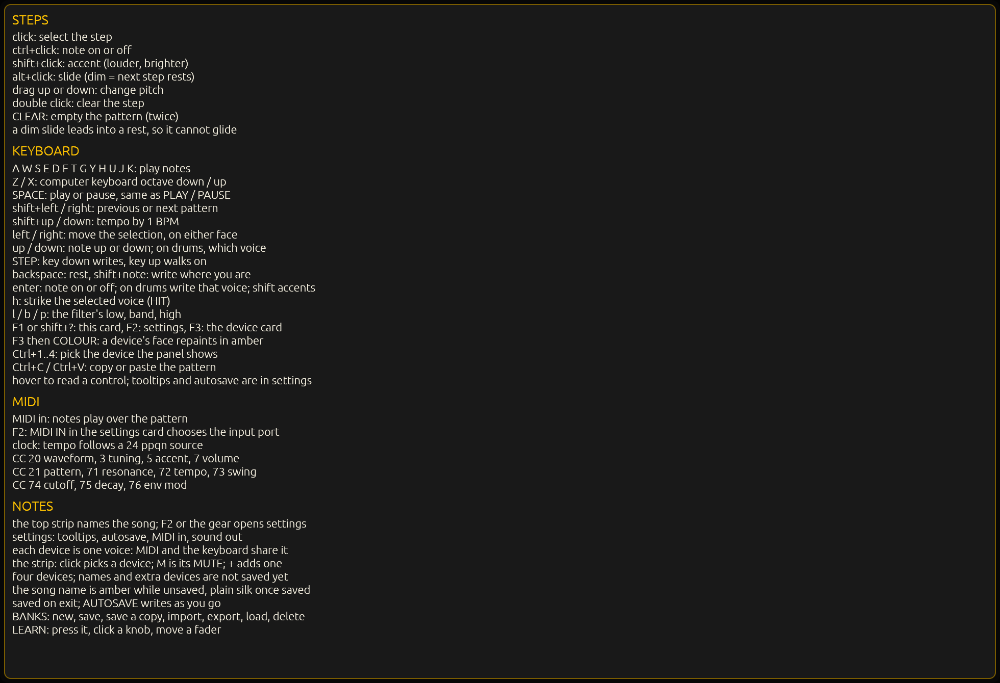
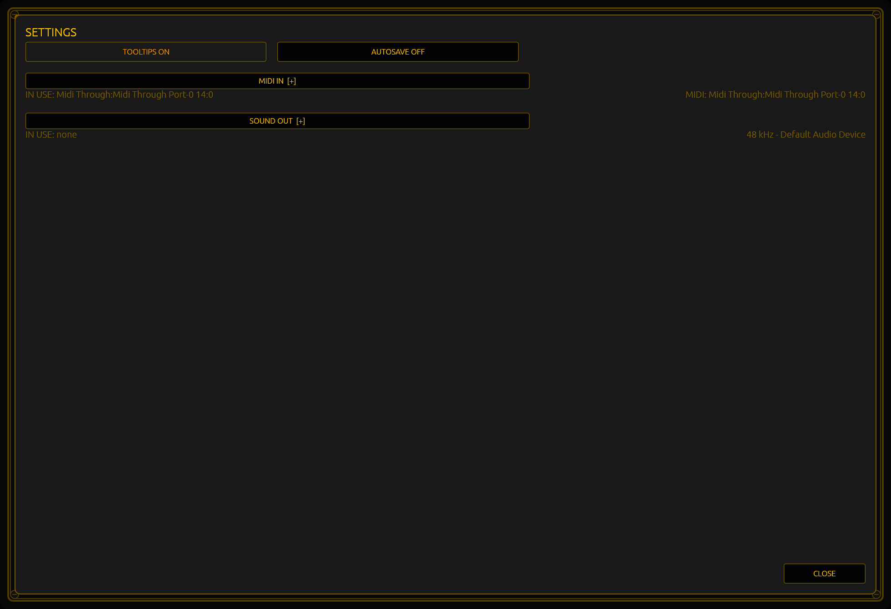
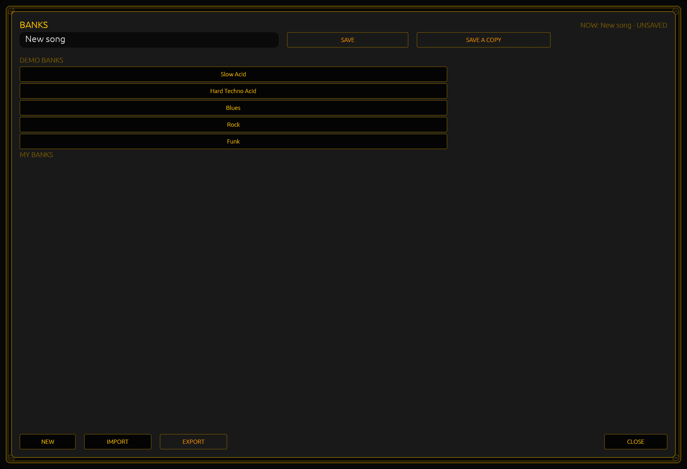
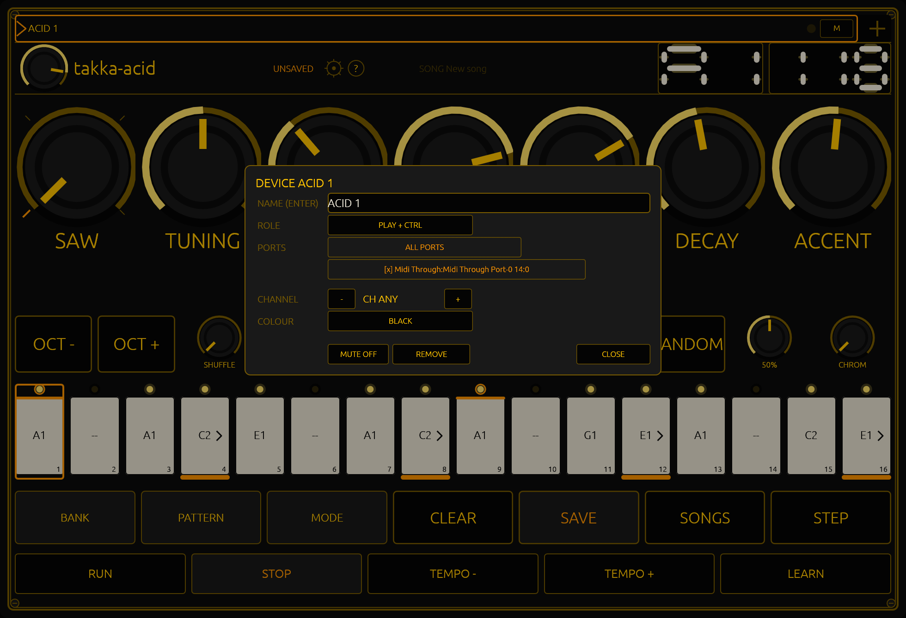
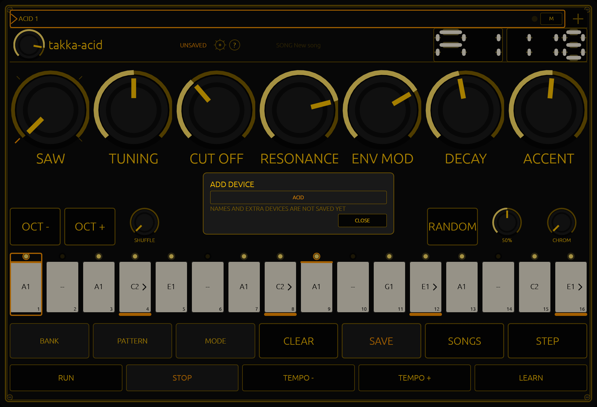

# The cards

Five cards open over the panel — **help**, **settings**, **songs**, a device's card and a drum machine's **kit browser** —
and a sixth thing opens over them: the **picker**, the strip's `+`.

Each card dims the face behind it and swallows clicks meant for the panel, so nothing can be edited behind a card by the
pointer. While **any** card is up — help, settings, the songs card, a device's card, the kit browser, or the picker — the
editing keys are spent too, so a stray `enter` cannot change a step you cannot see. The transport keys still work: `SPACE` starts
and stops the line even with a card open.

## Help — `F1`, `shift+?`, or the `?`

The whole instrument's gestures, keyboard, MIDI and vocabulary on one card: which click does what to a step, which letters
play notes, which controllers are already mapped, which keys pick a device or copy a pattern.

**Out:** any click closes it, and so do `Escape`, `F1` and `shift+?`.

## Settings — `F2`, or the gear

Tooltips and autosave, then the two device lists — MIDI in and sound out — each folded to its heading, with the device in
use named under it. `MIDI IN` is which ports the app holds **open**; which of them a *device* listens on is that device's
card's business. [`13-settings`](13-settings.md) walks the card.

**Out:** `CLOSE` in the bottom-right corner, `Escape`, or a click outside the card.

## Banks — `BANKS`

The card with the most on it: a search field, the chips `ALL` `SONGS` `BANKS` `RACKS` `DEMOS`, one list of every song, bank,
rack and demo, the strip whose field and keys follow the chip, and `NEW`,
`IMPORT`, `EXPORT` and `CLOSE`. [`12-songs-and-demos`](12-songs-and-demos.md) walks that one.

**Out:** the same as settings: the card's own close, `Escape`, or a click outside it.

## A device's card — `F3`, or the caret on its cell

The name, role, ports, channel, colour, mute and removal of the device **on the panel** — not the one a click happened to
pass over. [`19-a-devices-card`](19-a-devices-card.md) is that page.

**Out:** `CLOSE`, `Escape`, or a click outside the card.

## The kit browser — `KIT` on a drum machine's card

The three kits that ship, then the player's own, with `IMPORT` and `CLOSE`. It is opened from a drum machine's card and
puts that card away, like every other card does. [`19-a-devices-card`](19-a-devices-card.md#the-kit) is the card's side of it
and [`22-the-drum-machine`](22-the-drum-machine.md) the machine's.

**Out:** `CLOSE`, `Escape`, or a click outside the card.

## The picker — `+` on the strip

What `+` opens: a row for every kind of device there is — `ACID` and `DRUMS`. At four devices the row is greyed and a click
says the rack is full. It closes itself when a row is clicked.
[`18-a-rack-of-devices`](18-a-rack-of-devices.md) is that page.

## One card at a time, and which one gives way

Opening one puts the others away. `Escape` gives up on one thing at a time, in the order the cards are painted — topmost
first, so the nearest thing to your hand goes first:

1. the **picker**;
2. the **device card**;
3. the **kit browser**;
4. the **settings** card;
5. **help**;
6. the **songs** card;
7. a `LEARN` that is still waiting for a controller.

So one press from the picker puts you back on the pattern, and the next one gives up on the settings card behind it. The
details are the code's, in `ui/dispatch.rs`, and the guide's version of a card — how big it is, where its keys sit — is a
picture of it rather than a description.
