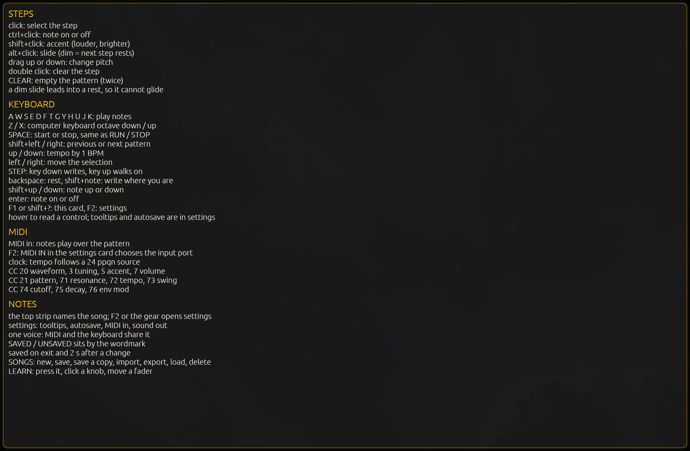
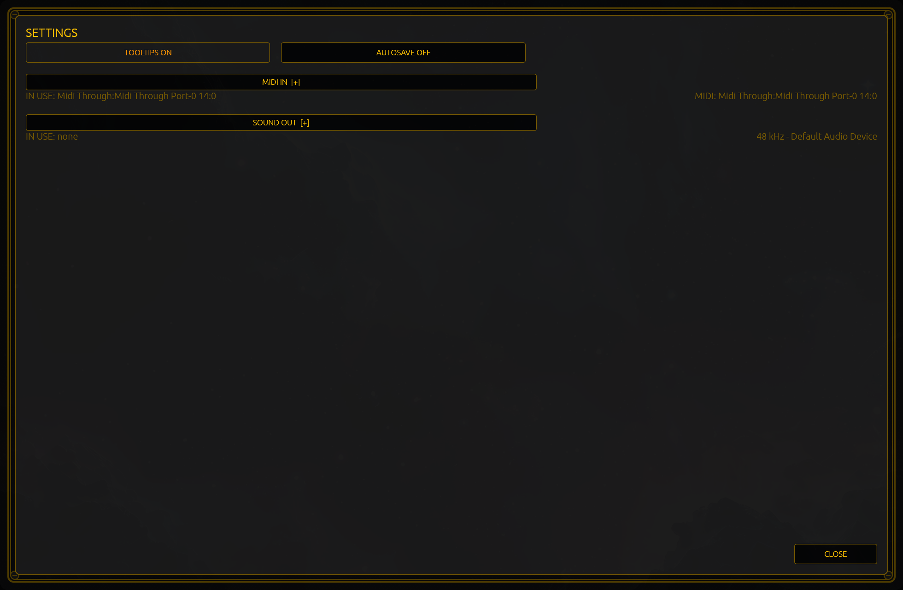

# The three cards

Three cards open over the panel: **help**, **settings** and **songs**. One at a time, mostly: opening **settings** puts help
and the songs card away, opening **help** puts settings away, and the **songs** card is drawn over whatever else is open —
so while it is up, it is the card you are in.

Each card dims the face behind it and swallows clicks meant for the panel, so nothing can be edited behind a card by
While **help** or **settings** is up, the panel's editing keys are spent, so a stray `enter` cannot change a step you
cannot see. The transport keys still work: `SPACE` starts and stops the line even with a card open.

## Help — `F1`, `shift+?`, or the `?`

The whole instrument's gestures, keyboard, MIDI and vocabulary on one card: which click does what to a step, which letters
play notes, which controllers are already mapped.

**Out:** any click closes it, and so do `Escape`, `F1` and `shift+?`.

## Settings — `F2`, or the gear

Tooltips and autosave, then the two device lists — MIDI in and sound out — each folded to its heading, with the device in
use named under it. [`13-settings`](13-settings.md) walks the card.

**Out:** `CLOSE` in the bottom-right corner, `Escape`, or a click outside the card.

## Songs — `SONGS`

The card with the most on it: the five demo songs, your own songs, the name field, and the buttons that keep, copy,
import, export, load and delete. [`12-songs-and-demos`](12-songs-and-demos.md) walks that one.

**Out:** the same as settings: the card's own close, `Escape`, or a click outside it.

## One card at a time, and which one gives way

The songs card closes neither of the others; it is drawn over them. `Escape` gives up on one thing at a time, nearest your
hand first: **settings**, then **help**, then **songs**, then a `LEARN` that is waiting for a controller.
One press from a card puts you back on the pattern; the next gives up on a `LEARN` that is still waiting.

There is no screenshot of the songs card in this book: it needs a pointer, and the machine that took these screenshots has
none. [`12-songs-and-demos`](12-songs-and-demos.md) describes it in words instead.
