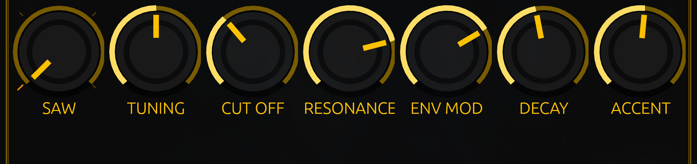

# The knobs

Seven knobs change the sound, and an eighth — in the top-left corner of the panel, out of this row — changes how loud it
is. Every one of them is a **position**, not a number: there is nothing to type and nothing to read, because the machine
is an instrument and not a plug-in with a form to fill in. `07-a-starting-patch` gives you positions that make a sound.

How they answer the hand is the same for all of them:

- **Drag up or down.** The whole sweep is a short drag — about 180 pixels end to end, so a firm pull is all it takes.
- **Hold shift while you drag** for a tenth of the movement — the way to land on a value you mean.
- **The mouse wheel** nudges the knob under the pointer.
- **Double-click** puts a knob back to the centre of its sweep.
- **Hover** and it tells you its name (with tooltips on, which is the default).

Every one of them can also be taught to a MIDI controller — `14-midi` shows how — and every one of them is read back from
the engine each frame, so a controller's fader and the painted knob never disagree.

## SAW — the wave

Not a dial but a switch with four faces: **SAW**, **SQR**, **SINE**, **TRI**. It snaps to the nearest face, and its caption
is the face it is on, so the knob always prints where the sound is.

*What it does to its neighbour:* it decides what the filter has to chew on. A sawtooth is the richest — the most
harmonics, the widest sweep when the cutoff moves. A square is hollow, a triangle softer, a sine a pure tone the filter can
barely touch. With a sine you have taken the filter's job away.

## TUNING

The pitch of the whole machine, an octave either side of centre. Centre is the tuning it was built at: the notes you write
are the notes you hear. Everything else is a shift, for playing against a record or for a line that sits high.

*Neighbour:* it changes which harmonics are under the cutoff, so tuning up with the filter low reads as a brighter line,
not just a higher one.

## CUT OFF

The filter's edge: everything below it survives, everything above it is cut away. Low is a muffled, closed-mouth bass;
high is bright and open. The sweep is wide and the useful part is spread across it, so a small move low down can change
more than a big one high up.

*Neighbour:* cutoff and resonance are one control in two halves, and the acid sound lives where the two meet.

## RESONANCE

How hard the filter rings at its edge. The first third is almost tame; the last third screams. High resonance puts a
whistle on any harmonic the cutoff passes over, which is why it is played *with* the cutoff rather than on its own.

*Neighbour:* raise resonance with the cutoff high and you get a piercing whistle instead of a voice — the same setting with
the cutoff lower is the 303's throat.

## ENV MOD

How far the envelope opens the filter on each note: the "wow" at the front of every note. At zero the filter stays where
you put it, and the line is static; high, every note kicks open and closes again.

*Neighbour:* env mod decides how far, decay decides how fast. Env mod with a long decay is a slow sweep; env mod with a
short decay is a pluck.

## DECAY

How long the envelope takes to fall, from a click to a long tail. This is the knob that makes an acid line talk: short,
and every note is a syllable; long, and the notes smear into each other.

*Neighbour:* with env mod at zero, decay has nothing to control — the filter never moved. The two are read together.

## ACCENT

How hard an accented step pushes. At zero, an accent is neither louder nor brighter and the accent marks on your steps do
nothing; turned up, each accented step gets louder and gets a short bright kick into the filter that falls away in a
fraction of a second.

*Neighbour:* accent is louder **and** brighter, so it fights the cutoff you set: with the filter wide open there is little
headroom left for the kick to use.

## The volume knob, top left

The level out of the machine — not part of the sound. It sits in the corner of the top strip rather than in this row
because it is not something you shape a line with; it is the knob you turn when the neighbours knock.

`07-a-starting-patch` puts all eight in one place.
