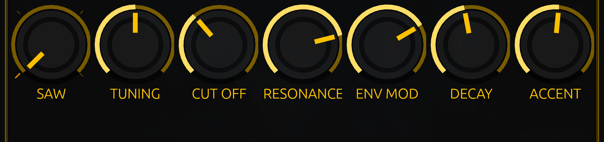

# A starting patch

The **Slow Acid** demo — the line a first run opens on — is a patch worth knowing by heart, because it is the sound the
rest of this book assumes: a saw, a filter that is open enough to hear the slides, and resonance doing the talking.

Here it is, as positions. The picture above them is the target: `06-the-knobs` names every knob, and the panel obeys its
own picture.

| Knob | Where the hand goes |
|---|---|
| **SAW** | the first face: the plain sawtooth |
| **TUNING** | dead centre — the line plays as written |
| **CUT OFF** | a third of the way up |
| **RESONANCE** | three quarters of the way up |
| **ENV MOD** | about seven tenths — near the top, not at it |
| **DECAY** | just under half |
| **ACCENT** | just over half |
| **VOLUME** (top-left corner, outside this row) | nearly all the way up |

That is the whole patch. The demo plays it at 118 BPM with no swing; the tempo and swing you choose are yours.

## Why that makes acid

Three things, and they are all couplings rather than single settings.

**Resonance three quarters, cutoff a third.** The filter is ringing hard, but the edge is low enough that it is ringing on
the line's own fundamentals, not above them. Raise the cutoff with the resonance left there and the sound thins into a
whistle; drop the resonance and the line goes flat.

**Env mod high, decay just under half.** Every note opens the filter by most of the available sweep and closes it in a
fraction of a second, which is the pluck that makes a bass line speak rather than hum. This is the pair to reach for when
you want the line to sound like it is enunciating.

**Accent just over half.** The accented steps are louder and get a kick into the filter, but not so much that the line
turns into a stutter of bangs. Slide into an accent and you get the classic 303 phrase: a glide that lands on the loud
note.

## What it is not

There is **no numeric readout on the panel and nothing to type**. The knobs are positions: "a third" and "three quarters"
are as exact as the instrument gets, and they are exact enough — the picture in `04-the-face`, taken from this very demo,
is the reference you dial against.

If your version of it sounds a little different to the demo, that is expected: how far a drag travels depends on the
window, and how it sounds depends on your ears. Dial until the line speaks, then leave it alone and write the next one.

From here: `08-writing-steps` puts notes where there are none.
