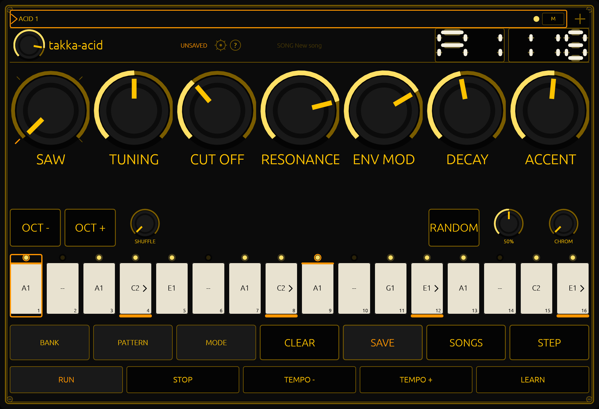

# Playing it

**`PLAY`** starts the line, **`PAUSE`** stops the clock and keeps the bar, and **`STOP`** puts it back at the top. The space bar
plays and pauses. The deck says what is happening rather than what happened last: `PLAY` is lit while the line runs, `PAUSE`
while it is paused.

## Tempo

The tempo readout sits in the top strip, in BPM, from **40–300**. Two things move it a BPM at a time:

- the small, stacked `-` and `+` beside the tempo's number, one BPM each way.
- `up` and `down` on the computer keyboard.

There is a third way in, and it is not a nudge: a learned controller fader throws the tempo wherever you leave it
([`14-midi`](14-midi.md)).

Holding `up` or `down` sweeps the tempo; those two are the only keys in the panel that repeat while held.

## Swing

Swing makes the first of each pair of steps long and the second short by the same amount, so a pair always lasts exactly
two steps and the bar length never changes however far you turn it. At zero the sixteenths are even; turned up, the second
of each pair arrives late and the line leans. That lean is the shuffle.

The knob is **`SHUFFLE`**, in the performance row, and it is [`10-performance-row`](10-performance-row.md)'s subject.

## Why the step LED follows the sound

The panel keeps no clock of its own. Every frame it asks the **audio engine** where it is in the pattern and lights the LED
over that step, so the light is where the sound is rather than where a timer in the panel thinks it should be.

Two things follow. The light and the sound cannot drift apart when the machine is busy: the panel may skip a frame, and the
light is then a frame behind, but it never runs ahead of what you hear. And because a step that holds a note keeps its LED
lit whether or not the transport is on it, the *moving* light is easiest to follow across the rests — which is exactly
where you want to know where the bar is.

A stopped line lights no position: the row shows which steps carry notes and nothing else.

## Starting and stopping

`PAUSE` leaves the step where it is and `PLAY` carries on from it; `STOP` does not resume — the next play starts again from
step 1, with the clock
on the downbeat, so the first note you hear after a start is always the first note of the bar. Nothing is quantised: your
presses land when you press them.

The pattern itself is untouched by any of this. The transport is performance, not part of the file: playing, pausing and
stopping mark nothing unsaved, because the session that gets saved has no field for them.

[`10-performance-row`](10-performance-row.md) is what to reach for while the line is playing.
