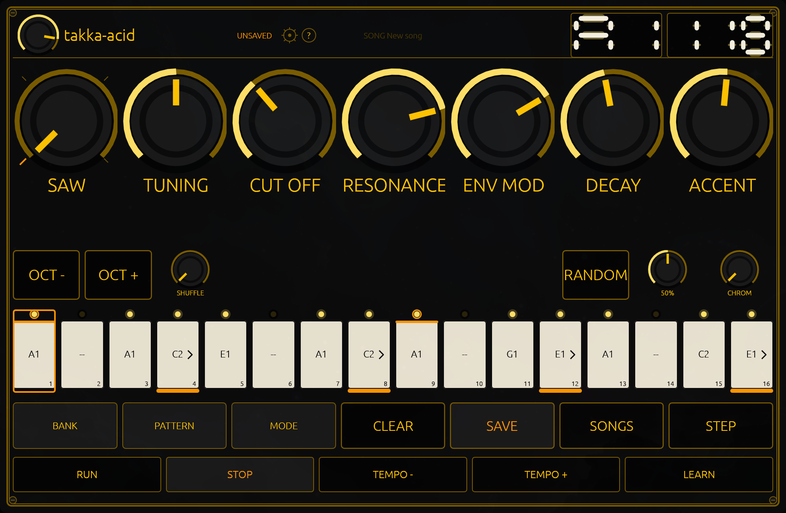

# Playing it

**`RUN`** starts the line and **`STOP`** stops it; the space bar is both. While it runs, `RUN` goes dark and `STOP` lights
up, so the transport always says what is happening rather than what happened last.

## Tempo

The tempo readout sits in the top strip, in BPM, from **40 to 300**. Three things move it, all by a single BPM:

- `TEMPO -` and `TEMPO +`, one press each way.
- `up` and `down` on the computer keyboard, one BPM each.
- A learned controller fader, which covers the whole range in one sweep (`14-midi`).

Holding `up` or `down` sweeps the tempo; those two are the only keys in the panel that repeat while held.

## Swing

Swing pushes the even-numbered steps late and pulls the odd ones early, by the same amount, so a pair of steps always
lasts exactly two steps and the bar length never changes however far you turn it. At zero the line is straight; pushed up
it becomes a shuffle.

The knob is **`SHUFFLE`**, in the performance row, and it is `10-performance-row`'s subject.

## Why the step LED chases the sound

The keys light one at a time as the line plays. That light is not a metronome running in the panel: it is the **audio
engine's own position** in the pattern, read back once a frame. So the lit key is the note you are hearing, not the note
you are about to hear — which matters the moment the machine is working hard, because the sound and the light stay
together even when the panel is late to draw.

It also means the LED row is honest in the two cases you would otherwise notice most: change the tempo while the line
runs and the light follows at once, and a stopped line leaves the light wherever the music stopped.

## What the transport does not do

It does not restart the line on a stop, and it does not quantise your presses. Stop in the middle and the line resumes
from the step the engine was on; the pattern is where you left it.

`10-performance-row` is what to reach for while the line is playing.
