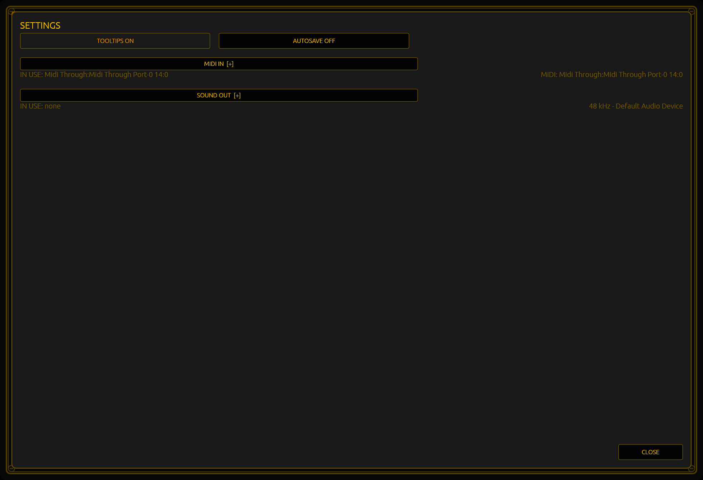

# Settings

`F2`, or the gear beside the `?`, opens the settings card. It is four things: two switches, and two device lists folded
behind their headings.

## The two switches

**`TOOLTIPS ON`** — hover help. Turn it off and the panel stops explaining itself; the switches and keys go quiet, and the
tip you were reading is gone. It is on by default.

**`AUTOSAVE OFF`** — **saving is manual by default.** With autosave on, the session is written two seconds after a change
without your asking; with it off, nothing is written while you play — `state.json` and the open song are written when you
close the app, and `SAVE` is what keeps them current as you go. Nothing here can make that decision for you: if you are
exploring, leave it off and watch the lamp.

Both switches print their own state, so there is never a switch that always says `ON`.

## `MIDI IN  [+]`

A folded section: the heading, then the device **in use** under it on the left, and the app's words about it on the
right. The right-hand words are one of four:

- `MIDI: <name>`, or the names in a list — those ports are open.
- `MIDI: none (retrying)` — no port yet: the app tries again every two seconds, and gives up after about half a minute.
- `MIDI: none (gave up)` — it has stopped trying. A **`RETRY`** key appears next to the section while this is showing;
  pressing it starts the attempt again.
- `MIDI: off` — every row is turned off, so there is nothing to try and no `RETRY` to press.

Under it, `IN USE:` followed by the name of every port that answered, or `IN USE: none` when none has. Unfold the heading
with `[+]` and you get the ports themselves, one row each: `[x]` is a port the app is holding open and `[ ]` is one it is
not, and a click moves a row to the other state. Any number may be on at once. There is no `none` row any more: turning
every row off is what "none" now is. A port the machine has stopped reporting keeps its row, marked `(missing)`, so a
controller with its cable out can be turned off without plugging it back in. A long list scrolls.

A fresh session opens the first port the machine reports, and the session remembers the first port it had open: the next
one asks for that by name, and if it is not there it says so rather than quietly taking a different device.

This card decides which ports are **open**. What each *device* hears among them — which ports, which channel, and whether
it plays notes or only answers controllers — is on that device's card ([`19-a-devices-card`](19-a-devices-card.md)).

## `SOUND OUT  [+]`

The same shape for audio: `IN USE:` on the left, and the stream's own words on the right — `48 kHz - <device>` when it is
healthy, or `failed: …` followed by the reason when the stream has stopped. There is no `none` row here, because an audio
stream needs a device to land on.

## What the card does not say

## `CLOSE`

Bottom right, and `Escape` and a click outside the card do the same. The card has no other exit: the folds and the device
rows stay as you left them until the app closes.

[`14-midi`](14-midi.md) picks up where the `MIDI IN` list leaves off.
