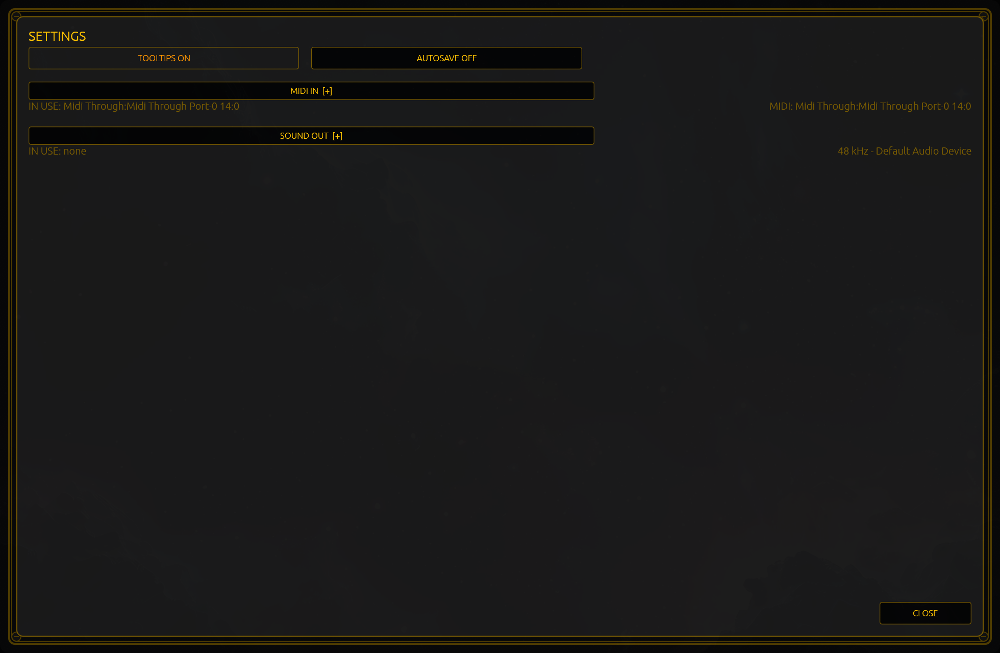

# Settings

`F2`, or the gear beside the `?`, opens the settings card. It is four things: two switches, and two device lists folded
behind their headings.

## The two switches

**`TOOLTIPS ON`** — hover help. Turn it off and the panel stops explaining itself; the switches and keys go quiet, and the
tip you were reading is gone. It is on by default.

**`AUTOSAVE OFF`** — **saving is manual by default.** With autosave on, the session is written two seconds after a change
without your asking; with it off, nothing reaches the disk until you press `SAVE`. Nothing here can make that decision
for you: if you are exploring, leave it off and watch the lamp.

Both switches print their own state, so there is never a switch that always says `ON`.

## `MIDI IN  [+]`

A folded section: the heading, then the device **in use** under it on the left, and the app's words about it on the
right. The right-hand words are one of three:

- `MIDI: <name>` — a port is open.
- `MIDI: none (retrying)` — no port yet, and the app is trying again on its own.
- `MIDI: none (gave up)` — it has stopped trying. A **`RETRY`** key appears next to the section while this is showing;
  pressing it starts the attempt again.

Under it, `IN USE:` followed by the device's full name, or `IN USE: none` when nothing is open. Unfold the heading with
`[+]` and you get the ports themselves, each row clickable, with `none` at the bottom to close the port. A long list
scrolls. The chosen port is remembered: the next session asks for that one by name, and if it is not there it says so
rather than quietly taking a different device.

## `SOUND OUT  [+]`

The same shape for audio: `IN USE:` on the left, and the stream's own words on the right — `48 kHz · Default Audio
Device` when it is healthy, or `failed: …` followed by the reason when the stream has stopped. There is no `none` row
here, because an audio stream needs a device to land on.

## What the card does not say

The help card's notes say the session is saved on exit and again a couple of seconds after a change. Only the first half
is unconditional: the two-second write happens when `AUTOSAVE` is on, and with it off there is no such write. The panel
behaves correctly; the help line is the one sentence in the app that says otherwise. [`17-trouble`](17-trouble.md) repeats the warning for
anyone who has lost work to it.

## `CLOSE`

Bottom right, and `Escape` and a click outside the card do the same. The card has no other exit: the folds and the device
rows stay as you left them until the app closes.

[`14-midi`](14-midi.md) picks up where the `MIDI IN` list leaves off.
