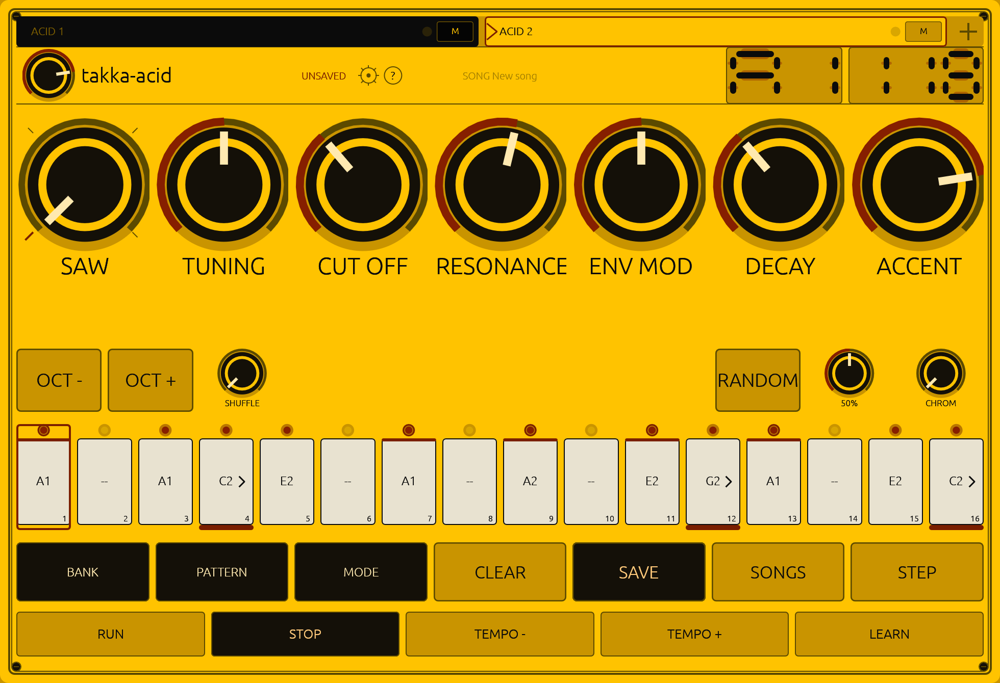

# A rack of devices

One window can hold **four machines**, and the strip above the panel is the whole rack.

## The strip

A cell per device, left to right, then `+`. Each cell carries:

- **its name** — `ACID 1`, `ACID 2`, or whatever you typed on the device's card;
- **a lamp**, lit while that device's sequencer is running;
- **`M`**, that device's mute;
- **a border**, on the one cell the panel is showing, and a caret before its name — the way into that device's card.

Click a cell to put that device on the panel, or press `Ctrl+1` to `Ctrl+4`. The panel shows one device at a time; the strip is
how you know which of them you are editing before you turn anything.

**Clicking a cell is not a piano key.** It changes what you are looking at, and nothing else: the device you left keeps
playing, at its own tempo, with its own pattern.

## Adding one

`+` at the right end of the strip asks what kind of device to add — a picker opens with the kinds there are, and today there
is one, `ACID` — and a line under them says what a restart costs:

> `NAMES AND EXTRA DEVICES ARE NOT SAVED YET`

Click the row and the device is there, last in the strip and on the panel. At four devices the row greys out; the key still
answers, so a click says the rack is full rather than doing nothing.

## What a device is

Each device is a whole machine, not a subset of one:

- **its own sixteen steps** and its own **sixty-four patterns** in eight banks of eight;
- its own **seven knobs** and volume;
- its own **shuffle**, its own octave transpose, its own `RANDOM` density and scale;
- its own **MIDI inputs** — which of the open ports it hears, on which channel, and whether it plays notes or only answers
  controllers (that is its card's business, [`19-a-devices-card`](19-a-devices-card.md));
- its own **name**, and its own **colour**.

What they share is the clock and the sound card. `RUN` starts them all, the tempo is one tempo, and a device added while the
line is running comes in on the step the others are on rather than at the top of the bar. Two devices playing one pattern
therefore sound like one machine with two voices; two devices with different patterns sound like two machines playing
together.

## Mute, not stop

`M` on a cell silences that device without stopping it: the fade is 10 ms — a hundredth of a second, too short to hear as a
fade and long enough not to click — and the sequencer keeps running underneath. Unmute a bar later and it is where it would
have been.

## The colour

A device's face can be **black** or **amber**, and the card's `COLOUR` row is where you choose
([`19-a-devices-card`](19-a-devices-card.md)). Pick amber for one machine and black for the next and the strip tells them
apart before you click: its cells wear their own device's colours while the panel wears the selected one's.

## What a restart costs

The session file still holds one device — the first one's patterns, patch, swing and learned controllers, plus the first MIDI
port the app had open. Everything else about the others is in memory: their names, their patterns, their ports, their colours.
They are gone on restart, and the picker's own line says so.
