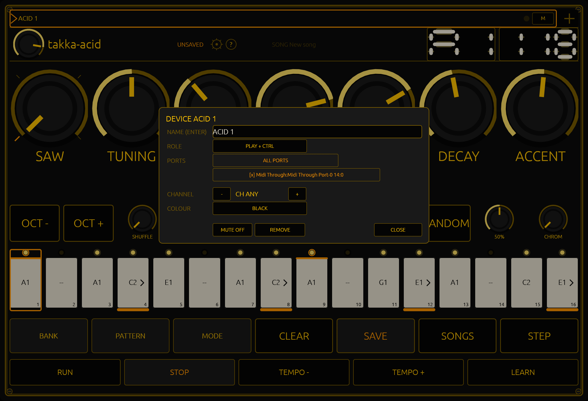
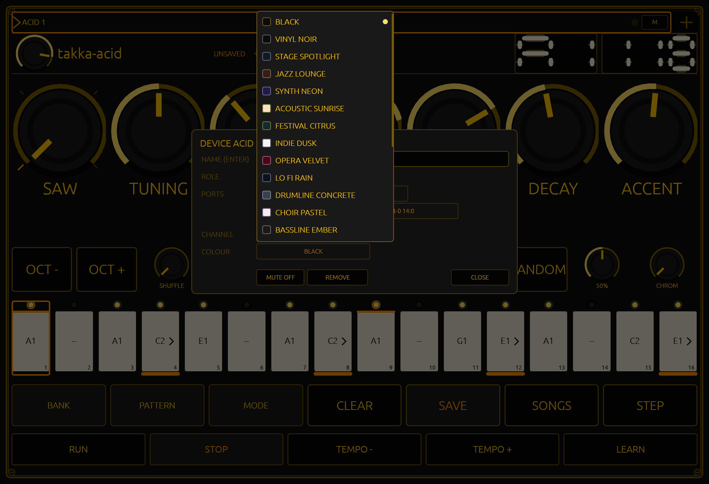

# A device's card

`F3`, or the caret on the selected cell, opens the card for the device on the panel.

Everything on it is about that one device, and every row acts on it immediately:

- **`NAME (ENTER)`** — what the strip and the notices call it. Type and press `enter`. A name another device already holds
  lands as `BASS (2)`, so two cells can never read the same.
- **`ROLE`** — `PLAY + CTRL` or `CTRL ONLY`. Controller-only is for a box of knobs on a channel of its own: it will not start
  a note just because a message arrived ([`14-midi`](14-midi.md)).
- **`PORTS`** — `ALL PORTS`, then one row per port the machine reports. A ticked row is a port this device hears; unticked,
  and it ignores that port even though the app has it open. Which ports are *open at all* is the settings card's.
- **`CHANNEL`** — `CH ANY`, or one channel of sixteen.
- **`COLOUR`** — the theme this device wears. A click opens the list of them.
- **`MUTE OFF` / `MUTE ON`** — the same mute as the cell's `M`, said in full.
- **`REMOVE`** — takes two clicks, like `CLEAR`. The second one is the answer.

**Out:** `CLOSE`, `Escape`, or a click outside the card.

## The theme

`COLOUR` opens a list of twenty-two themes, each row carrying a swatch of the face it would give this device. The theme in
use is the row with the dot. The list is longer than the card, so it opens over it and scrolls with the wheel; the bar on its
right edge is where you are in it. A click on a row puts the list away and repaints the device; a click anywhere else, or
`Escape`, puts the list away and leaves everything as it was.

A theme is a face and everything that has to go with it: the panel colour, the raised plates the knobs sit on, the legends
and their dimmed second weight, the lamp and its unlit state, the digits in the wells, the keycaps, and the tint the learn cue
uses. `BLACK` is the instrument's own and the one every device starts on. The others come from a page of page palettes — one
table row each, five colours and a polarity — and a rule derives the rest of the face from them, which is why they hold the
same reading rules the black face does rather than being pictures at a fixed size.

The catalogue runs from `VINYL NOIR` and `STAGE SPOTLIGHT` through `ORCHESTRAL ICE` and `AMBIENT MOSS` to `EDM LASER` and
`RETRO CASSETTE`; the list opens on the theme in use and the wheel finds the rest.

Six of the twenty-two are **light faces**: `ACOUSTIC SUNRISE`, `INDIE DUSK`, `CHOIR PASTEL`, `POP BUBBLEGUM`, `K POP CANDY`,
`STUDIO SANDALWOOD`. On a light face the lamps are dark marks rather than lights, because a lamp brighter than an already
bright face has nowhere to go.

The theme stays with the device, not with the window: put one machine on `ORCHESTRAL ICE` and the next on `AMBIENT MOSS`, and
the panel wears the selected one while each strip cell wears its own.

The four cards stay black whatever the face does. A card is furniture laid over the instrument, not part of it.

The theme is **not saved**. A restart brings every device back to `BLACK`.

## Removing a device

`REMOVE` asks twice: the first click turns the key into `CONFIRM?`, and any other key or click disarms it. Then the device
goes, its cell with it, and the panel moves to a neighbour. The last device cannot go — one machine is the minimum a rack can
hold.

Nothing on disk changes when a device is removed: the session file still holds the first device only, so removing that one
changes what the next save will write, and removing any other does not
([`12-songs-and-demos`](12-songs-and-demos.md)).

## One card at a time

The picker (`+` on the strip) is the card painted over everything, the device card is under it, and `F1`/`F2`/`F3` each put the
others away — [`05-the-three-cards`](05-the-three-cards.md) has the whole rule, including what `Escape` gives up first.
