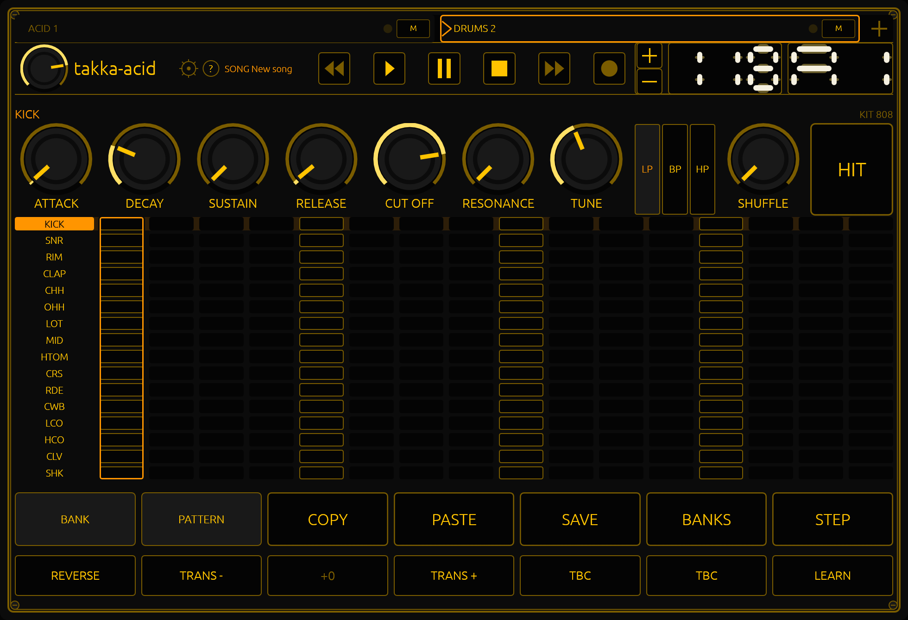
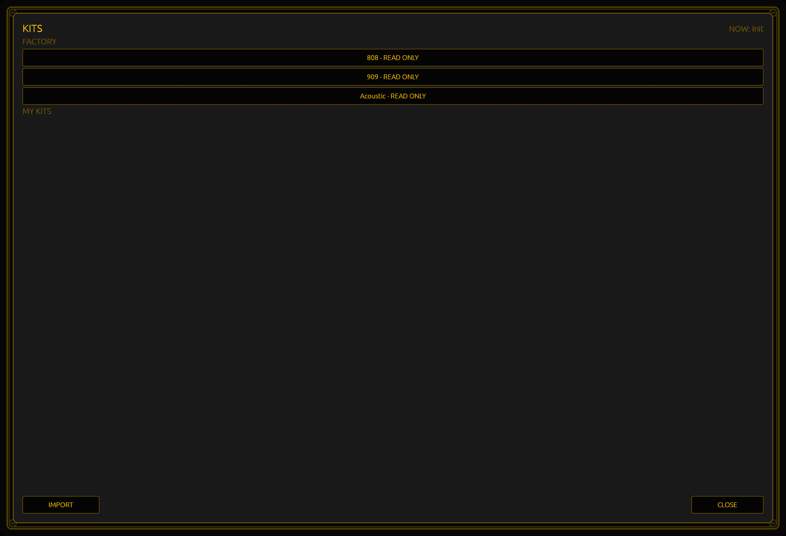

# The drum machine

A second kind of device, in the same rack and on the same bar: **sixteen sample voices against the sixteen steps**, where
the 303 has one voice against the same sixteen. Add one with `+` on the strip and pick `DRUMS`
([`18-a-rack-of-devices`](18-a-rack-of-devices.md)); everything a rack does — the transport, the tempo, `REVERSE`, the
transpose, the themes — it does to the drums the same way ([`05-the-three-cards`](05-the-three-cards.md) is the cards,
[`04-the-face`](04-the-face.md) the face the two machines share).

## The grid

The grid is the editor. On a drum machine it takes the bottom of the knob band and the whole of the performance and step
bands the 303 uses — **one row per voice, one cell per step** — and the seven dials keep the top of the knob band. Its sixteen
rows are the sixteen sounds, top to bottom:

| | | | |
|---|---|---|---|
| `KICK` | `SNR` | `RIM` | `CLAP` |
| `CHH` | `OHH` | `LOT` | `MID` |
| `HTOM` | `CRS` | `RDE` | `CWB` |
| `LCO` | `HCO` | `CLV` | `SHK` |

A click on a cell strikes that voice on that step; a click on a struck cell takes it off again. `SHIFT`-click accents it —
the 303's own accent gesture, louder and brighter — and an accent is printed brighter than a plain strike, so the pattern
reads at a glance. Every fourth column is framed in the silk, which is where the beats are.

Clicking a row's **label** selects that voice: its label becomes a lit plate in the accent, its row carries a faint band behind
the cells, and the name is printed above the dials. Neither a selection nor a mute makes a sound — `HIT` is how a voice is heard.
`SHIFT`-clicking the label **mutes** that voice: the label prints dim and the row's cells lose their accent, but they stay
readable, so a muted voice can be found and unmuted by eye.

`SHIFT` is the modifier throughout: a strike, an accent, a mute has a plain click and a `SHIFT`-click, never a menu.

The keyboard reaches the same selection: **`shift+up` / `shift+down` walk it up and down the grid** — the rows are the
grid's own order, `KICK` at the top. The walk selects and does not sound, like a click on a label. Held down, it repeats; it
stops at the top row and the bottom one rather than wrapping round. While a card is up the walk is spent, like the editing
keys, because a card is modal.

**`h`** strikes the selected voice — the same hit as `HIT` — so a kit can be walked with the arrows and heard with one key. A
card does not stop it: a hit is a sound, not an edit. The rest of the letters stay silent here; they are the 303's notes.

The step is edited the same way, one step over: **`left` / `right` move the selected step**, a lit column across the sixteen
rows, and **`enter` writes the selected voice into it** — silently, as a 303 step is written without a sound; a second `enter`
takes the hit off again. **`shift+enter`** is the grid's accent gesture, so an empty cell takes an accented hit, a plain strike
is accented and an accented one is taken off. The selection stays where it is after a write, unlike the 303's `STEP`, because a
step here holds sixteen voices and a hand writes several before moving on. `HIT` and `h` still play the voice without writing
it, either of them with the bar stopped.

## The dials

The seven knobs stay where the 303 puts them and are **the selected voice's**, not the machine's:

| Dial | What it does |
|---|---|
| `ATTACK` | how fast the voice's strike reaches full level |
| `DECAY` | how fast it falls from there to `SUSTAIN` |
| `SUSTAIN` | the level it holds while the voice is gated |
| `RELEASE` | how long it takes to fade once the gate closes |
| `CUT OFF` | the filter's corner, in the 303's own knob positions |
| `RESONANCE` | how much the corner is emphasised |
| `TUNE` | the voice's pitch, in semitones either way |

Beside the waveform switch's place is a three-way key, **`LP | BP | HP`** — low-pass, band-pass, high-pass. It is a different
filter from the 303's on purpose (a state-variable one, where the 303's is a ladder), but its cutoff and resonance are the
303's own knob positions, so a `BP` open hat and a `LP` kick are the same idea heard two ways. **`HIT`** plays the
selected voice once, with the transport stopped, which is how a voice is tuned without writing it into the bar.

**`SHUFFLE`** is the odd one out and sits apart from the seven, between the filter key and `HIT`: it is not the voice's
dial, it is the **device's** swing — the same clock control the 303 keeps in its performance row, and it swings the drums
exactly as it swings a bass line.

A dial moved on a factory kit copies that kit under a free name and says so on the status line: the kits that ship are
read-only ([`19-a-devices-card`](19-a-devices-card.md#the-kit)).

## The kits

A drum machine's sound is a **kit**: sixteen voices, each with a sample and the dials above. **The face names the kit it is
playing** — `KIT 808` in dim silk at the right-hand end of the line above the dials, smaller and quieter than the voice's name
at the left — and a drum machine's card carries a `KIT` row an acid device's does not, with the same name; a click on the row
opens the **kit browser**.

A drum machine arrives on `808`, the first kit that ships. `Init` is the name of a kit with sixteen voices and **no samples at
all** — the state a machine is in before any kit has been decoded — so `KIT Init` on the face means the machine has no sound
in it, not that the machine is broken.

Three kits ship — `808`, `909` and `Acoustic` — under `FACTORY`, each row marked `- READ ONLY`, and the player's own
under `MY KITS` with `IMPORT` and `CLOSE` along the bottom. A click on a row loads that kit into the device; while the kit
on the panel has edits that are not on disk, the first click only asks and the second one loads, the same two-click rule
as loading over an unsaved song.

`MY KITS` starts empty. A kit becomes a folder in the library the first time one of the factory kits is edited (the copy
above) and the session saved, or a folder of WAVs is imported: `<data>/kits/<name>/`, one WAV per sampled voice and a
`kit.json` naming them, so a kit can be copied, edited by hand and handed to someone else. A kit whose samples will not read
still loads: the voices that failed are silent and the status line names the file to replace. `kits/CREDITS.md` in the
repository records where every sample in the three that ship came from and that they are all CC0.

## The demos, as drums

`BANKS` is the same browser the 303 opens ([`12-songs-and-demos`](12-songs-and-demos.md)), with the same five demo names
under `DEMO BANKS` — **Slow Acid**, **Hard Techno Acid**, **Blues**, **Rock** and **Funk**. On a drum machine a click
loads that demo's **drum bank** instead of a song: eight grooves into `A1` to `A8`, at the demo's tempo and shuffle, with
this machine's kit and the session's name left alone. The acid line and its drums are two halves of one variation, and a
later round is where one gesture loads both.

A drum bank is patterns, not a song. The grooves last the session — a save still writes the first device only
([`18-a-rack-of-devices`](18-a-rack-of-devices.md)) — while the tempo it arrives with is the whole rack's, and is saved.

## What is not here

- **No notes.** A drum machine takes no notes at all this round: no letter plays a note on it
  ([`15-keyboard`](15-keyboard.md)) — `h` strikes a voice, and nothing writes a pitch — a MIDI note on its channel is silent
  ([`14-midi`](14-midi.md)), and `STEP` lights and toggles while writing nothing. `shift` and `up`/`down` move between its
  voices and `left`/`right` between its steps; `enter` writes that voice into that step and `shift+enter` accents it, and no
  letter writes a note. MIDI pads and per-voice controllers are a later round.
- **No step row, no performance row.** The grid's columns are the steps, and `OCT`, `CLEAR`, `RANDOM`, the density and the
  scale are the 303's. `BANK`, `PATTERN`, `COPY`, `PASTE`, `SAVE`, `BANKS` and `STEP` keep their places on the switches row.
- **One hit per voice at a time.** A second strike on the same voice retriggers it rather than layering, and a hat's
  choke group — the closed hat cuts the open one — is how the pair sounds like one hi-hat.
- **No per-voice hover help yet.** The seven dials, the filter key and `HIT` print their captions and nothing more; the
  shared keys keep the 303's tips.
- **`LEARN` has nothing to teach on the drum's own controls.** A drum voice takes no controller this round, so on a drum face
  `LEARN` can bind the shared controls — `VOLUME`, and the tempo and pattern readouts — and nothing on the voice's dials, the
  filter key or `HIT`. Those stand still while it is choosing a control, rather than turning the voice under a hand that meant
  to teach it.
