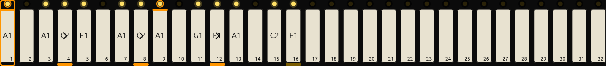

# Pattern grids

A pattern is **one bar of 4/4** — and a bar can be divided three ways. Which division a pattern is on is its **grid**,
and the grid belongs to the pattern: it is saved with it, copied with it and banked with it.

| Grid | Steps to the bar | What it is for |
|---|---|---|
| `1/16` | 16 | sixteenths: the line everything before this existed on |
| `1/32` | 32 | thirty-seconds: twice as fine, for fast rolls and broken slides |
| `1/8T` | 12 | eighth-note triplets, which sit *off* the sixteenth grid rather than inside it |

All three are **the same bar**: sixteen sixteenths, thirty-two thirty-seconds and twelve eighth-triplets last exactly as
long as each other. That is what keeps every machine in a rack on the same bar — a `1/8T` line and a `1/16` drum machine
still land their downbeats together, and a device joining a running rack still waits for the same bar.

## The key
In the transport row, beside the transpose pair: **`GRID`** and, next to it, the grid the pattern is on — `1/16`, `1/32`
or `1/8T`.

Press `GRID` to cycle the three. It is a **pattern edit**, not a transport setting: the pattern changes at once, the
row changes shape with it — sixteen keys, or twelve, or thirty-two — and the session is marked unsaved, because the grid
is part of the pattern and travels into the save file and the clipboard with it. The readout is dim at `1/16` and lit
otherwise, so "this pattern is not on the plain grid" is visible at a glance.

## What a press does to the steps outside the new bar

A press that makes the bar **shorter** stops playing whatever falls outside it — and **keeps it**. Nothing is destroyed:
a step the bar cannot hold keeps its note, stays silent while the bar is narrow, and plays again the moment a wider grid
arrives, including after a save. The status line says what the press costs in music —

```text
32 TO 12 STEPS, 2 HELD
```

— the bar before and after, and how many steps that **had sound** in them stopped playing. `HELD` is not `lost`: press
`GRID` twice more and those two notes are back where they were. A press that holds nothing just says the length
(`16 TO 32 STEPS`).

A press that makes the bar **longer** plays the steps it had been holding. The row grows with it, so they have keys to
land on again.

## The row and the beat



The row draws one key per step of the pattern's own grid, and the beat framing follows the grid: every fourth key is
outlined at `1/16`, every eighth at `1/32`, every third at `1/8T` — a beat is a quarter note at every one of them.

The drum machine's grid does the same with columns ([`22-the-drum-machine`](22-the-drum-machine.md)): a `1/32` pattern is
thirty-two columns wide and a `1/8T` one twelve, framed on the beats of its own grid.

## Elsewhere

- **`CLEAR` keeps the grid.** It empties the bar; it does not leave it. A `1/32` pattern stays thirty-two steps long.
- **`RANDOM` keeps the grid**, and rolls only the steps the bar holds.
- **The bank and the song keep each pattern's grid**, pattern by pattern, so one bank can hold a sixteenth line next to a
  triplet one.
- **The clipboard carries it**: a copied pattern takes its grid with it, which is why a build older than this one refuses
  a copied pattern instead of reading half of it.
- **Shuffle leans whatever grid you are on.** Even steps long, odd steps short, the pair still exactly two steps — so the
  bar does not change length at any swing setting, at any grid ([`10-performance-row`](10-performance-row.md)).
- **A pattern change from a controller still lands at the bar line**, at every grid ([`11-the-bank`](11-the-bank.md)).

Two of the demos are on the other grids — **Acid Jazz** on `1/8T`, **Fast Acid** on `1/32` — so you can hear what they are
for before writing one ([`12-songs-and-demos`](12-songs-and-demos.md)).
